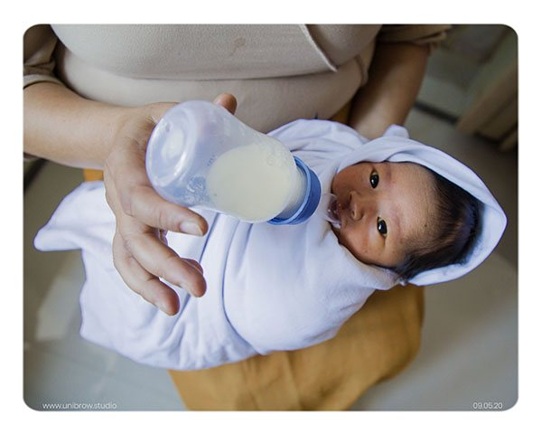
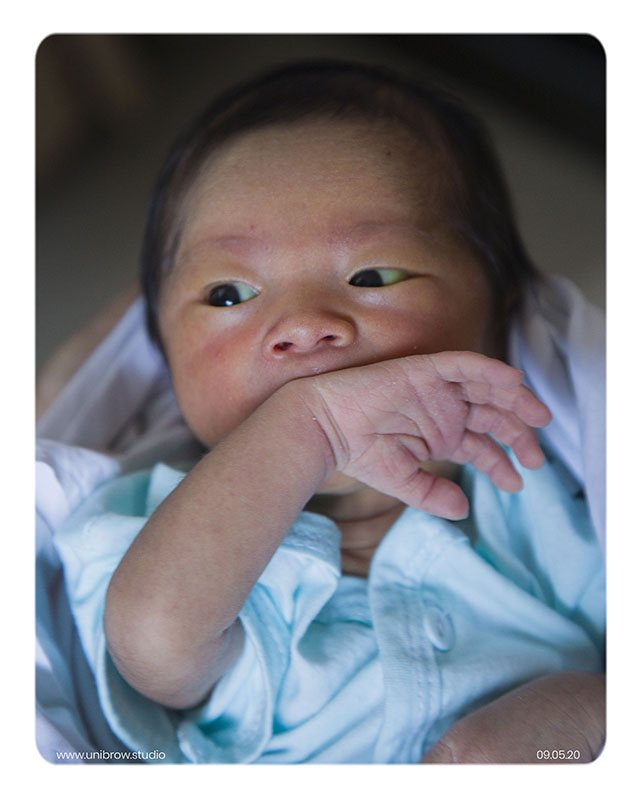
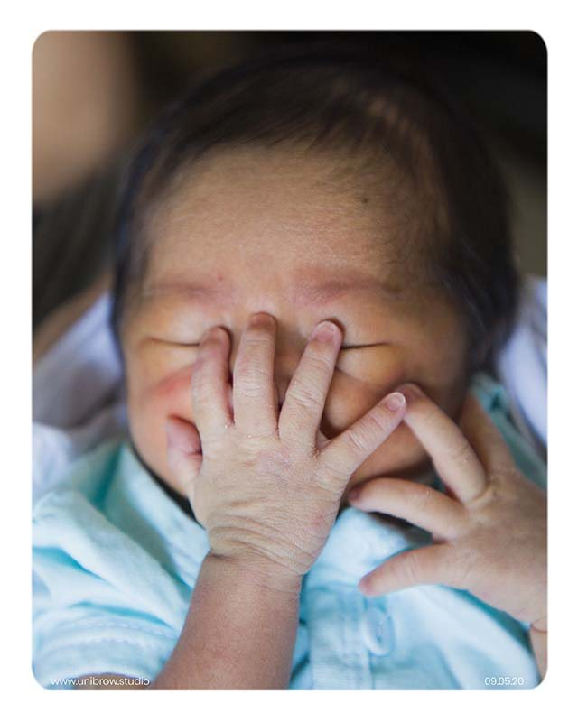
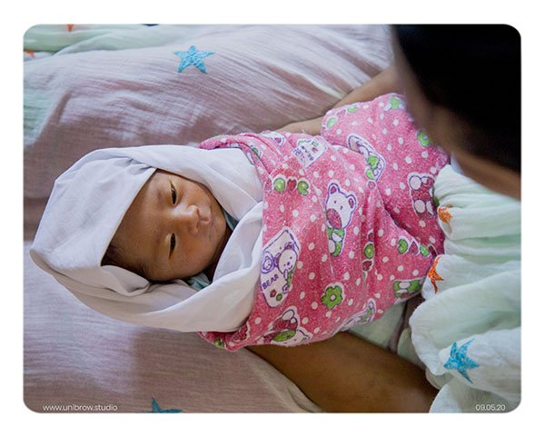
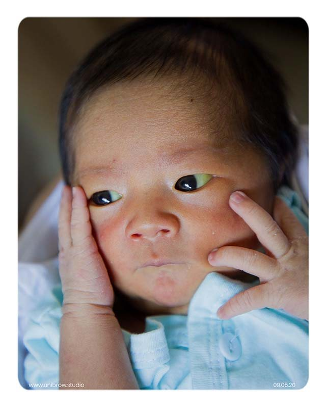
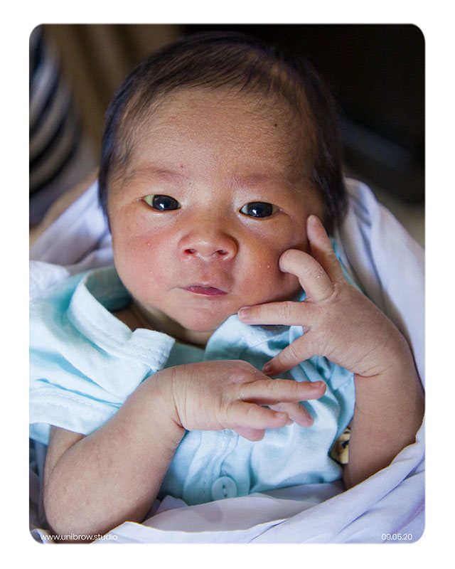
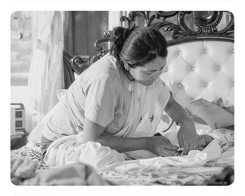

Babies are a beautiful reminder 
of the gift of life.

They bring joy and a certain kind of fresh tenderness that seems to come only with spring. They bring meaning into our lives and we smother them with love we never knew we were capable of before.

We see a bit of ourselves inside them, smile and vow —

"My son/daughter 
will become great."

### From the very first moment

From the first time they walk, 
the first time they call out mama, 
the first time they go to school — 
we gush with pride.

'My son finished three bowls of rice.' 'My daughter took 4 steps today.' We brag about the smallest details to other parents and mean every word of it.

Every time they fall or get hurt — 
we wish it had happened to us instead.

Life is a stormy path and if we could smoothen their journey even a tiny bit, we would instantly do so. In a way, their fragility brings us back to the most humane virtues — love and care.

### On time

Every moment becomes precious — 
every little quirk all the more significant.

Time does not take a single glance back — 
we cherish and etch those memories, 
holding on whatever way we can.

Pictures become fragments of emotions — 
we stare at them and look back in nostalgia, 
at the fond days that have long since gone.

