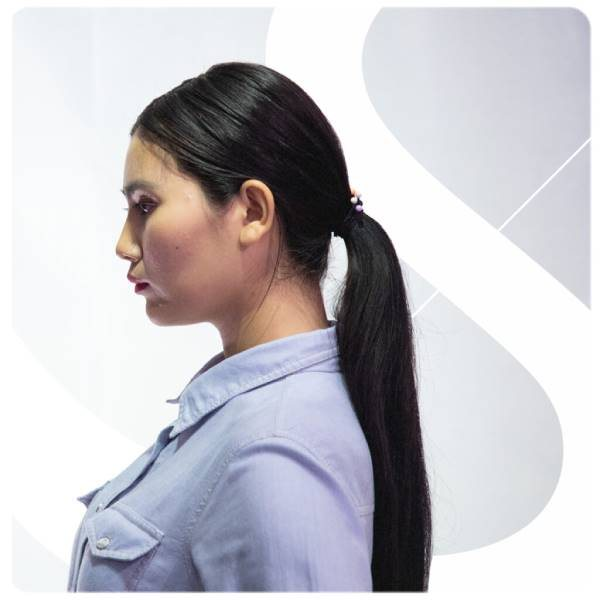
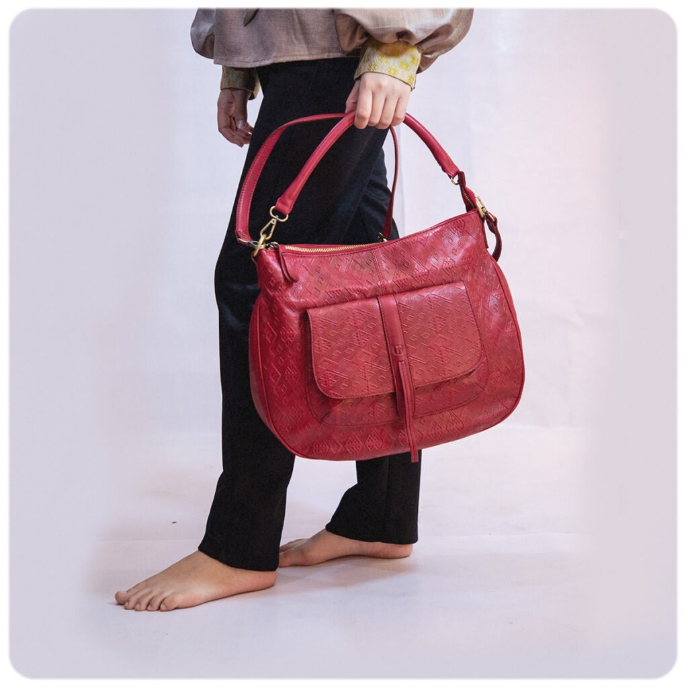
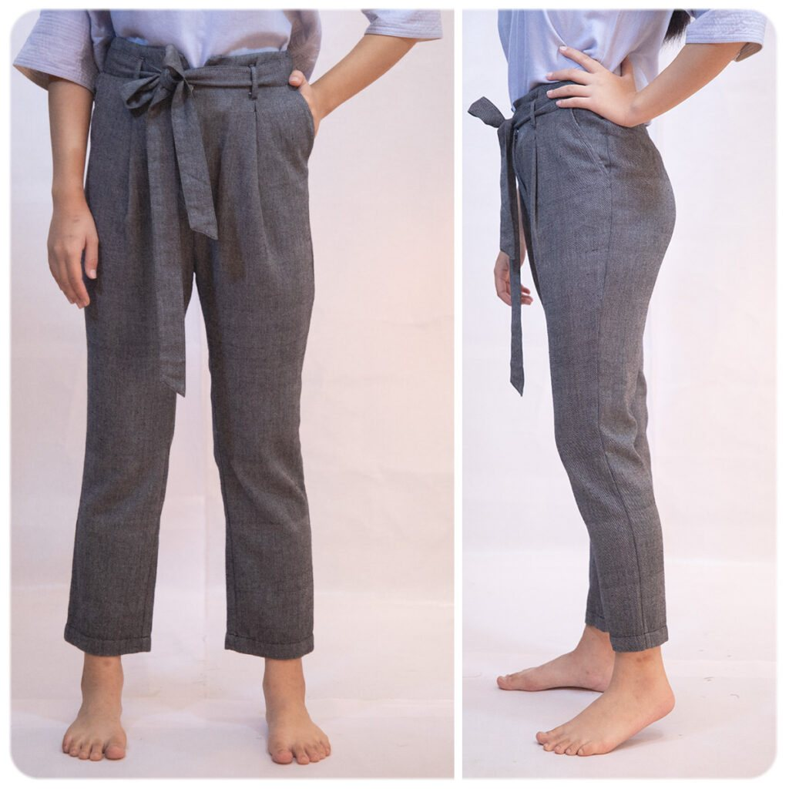
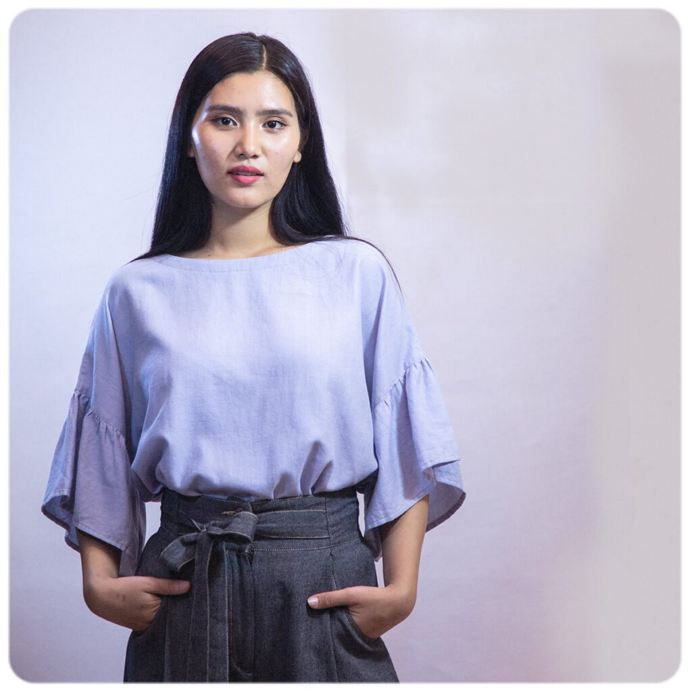
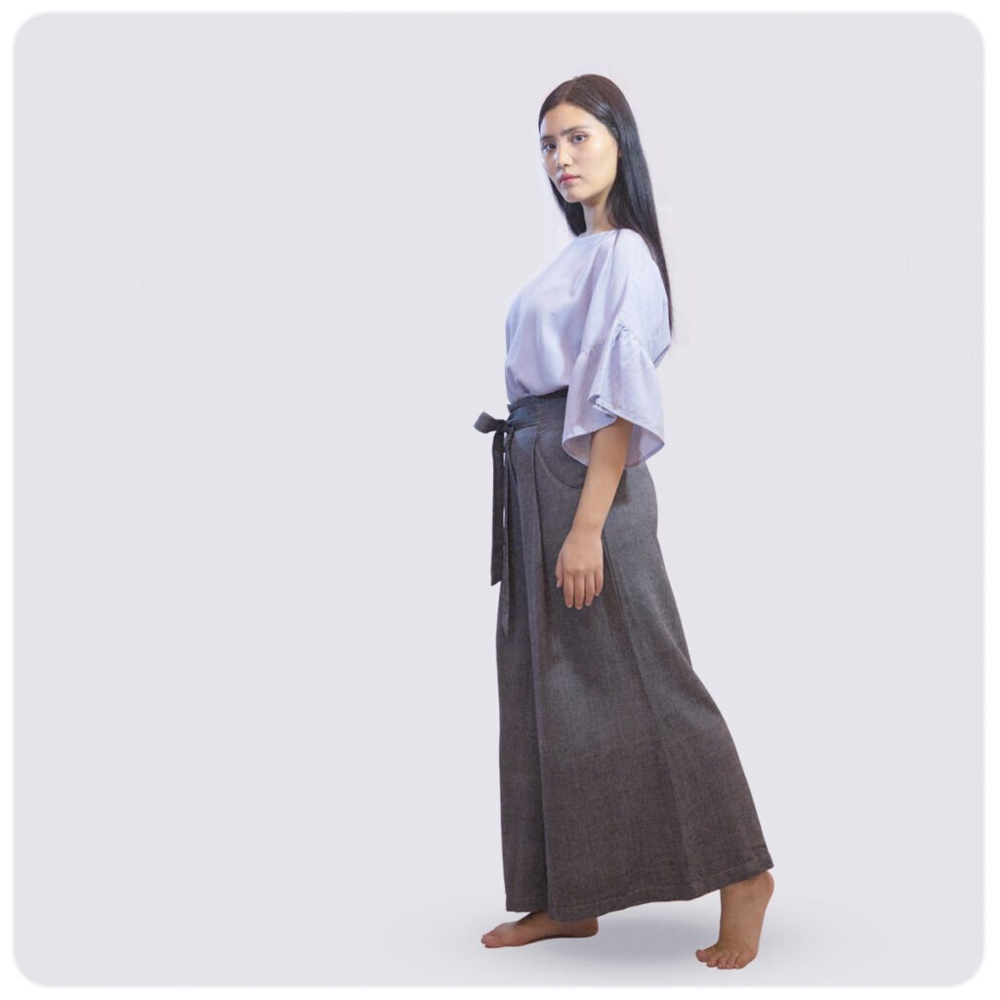
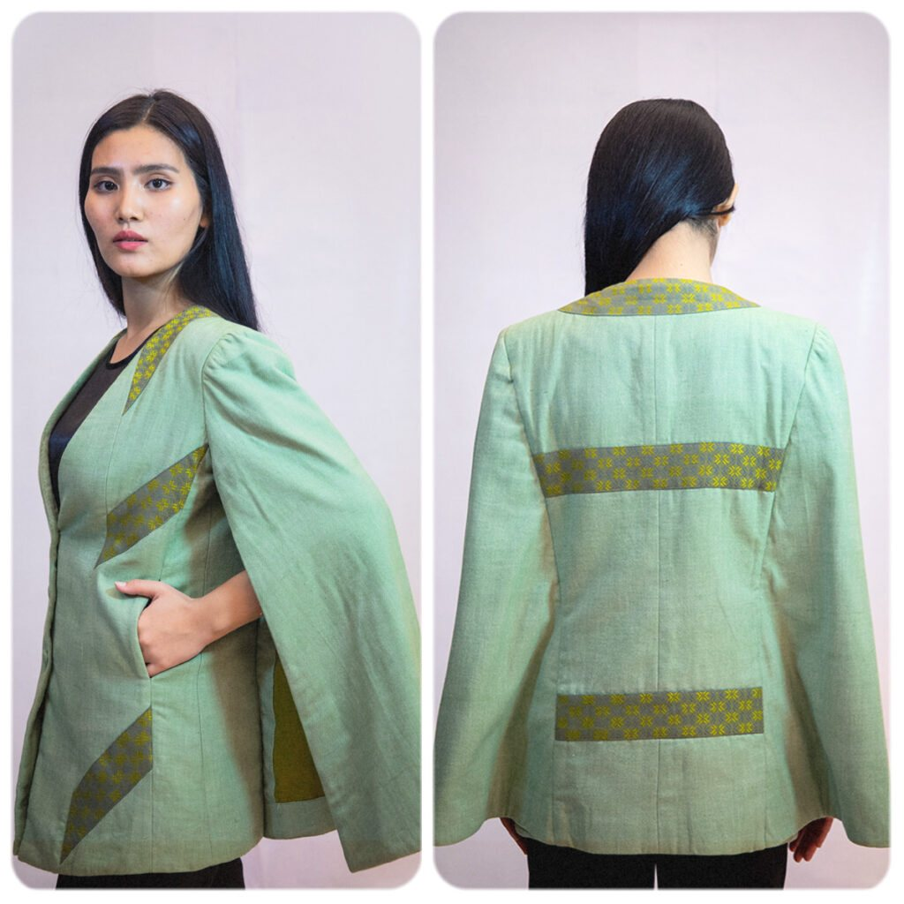
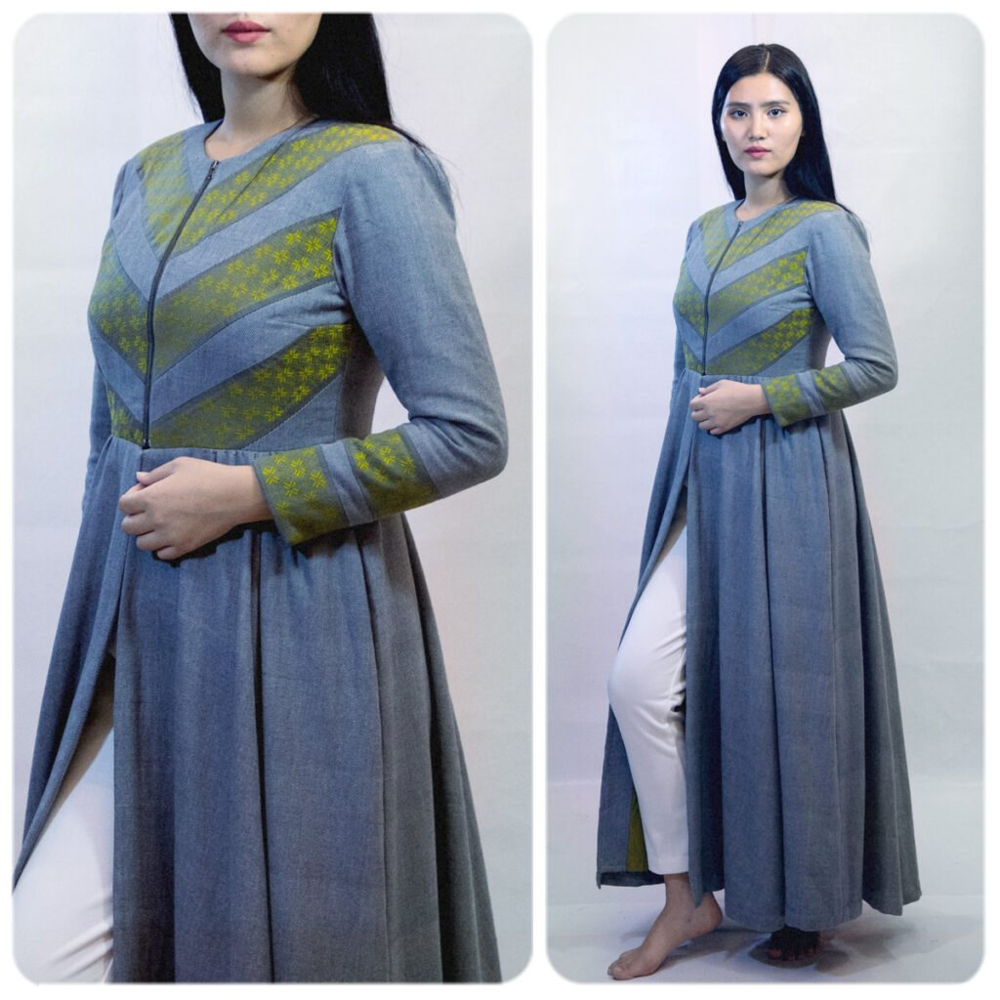
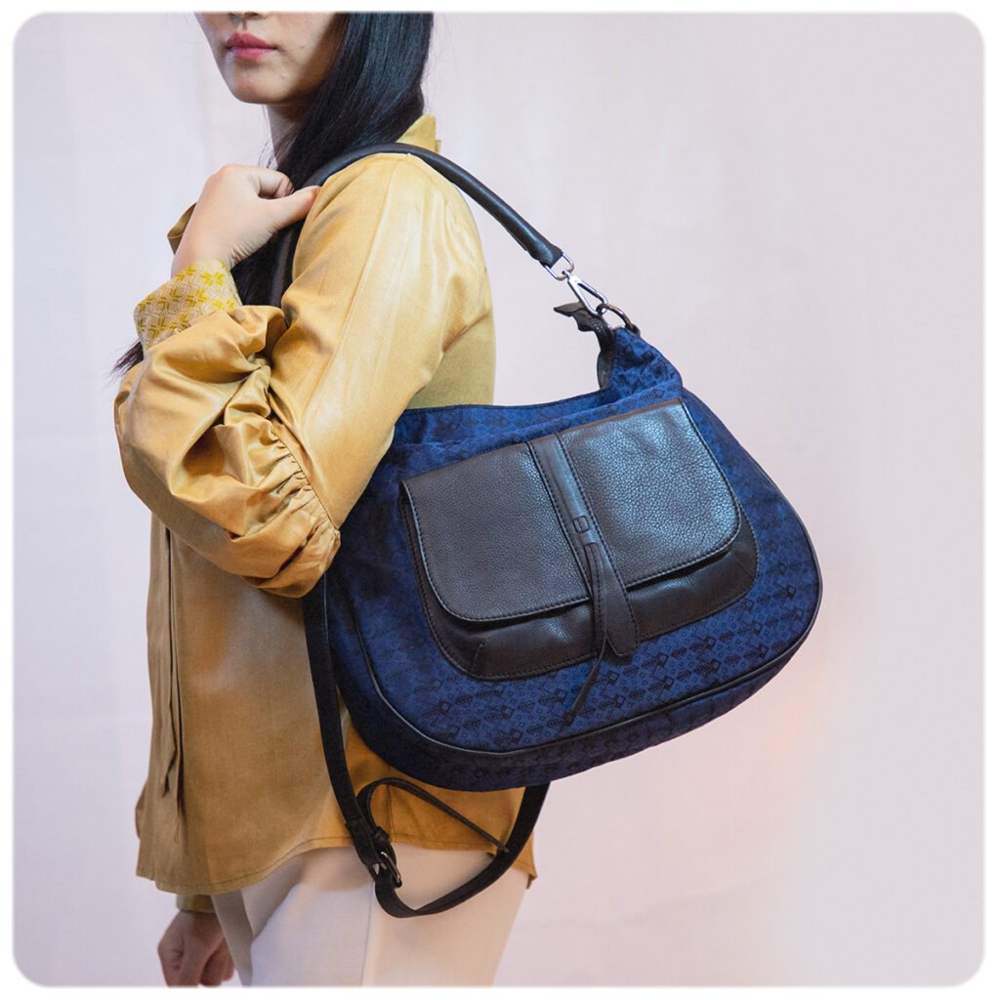
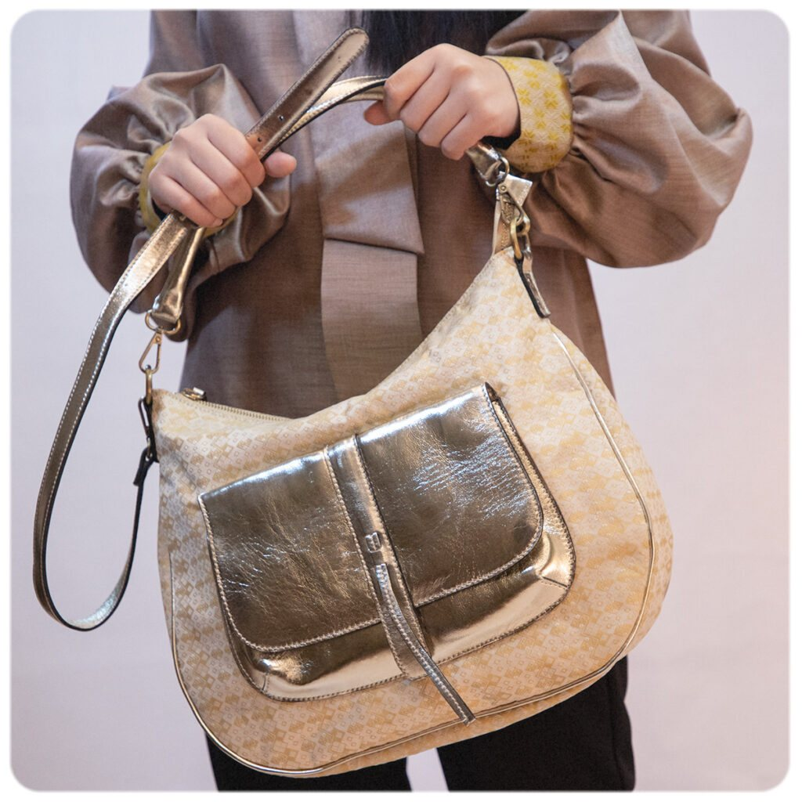
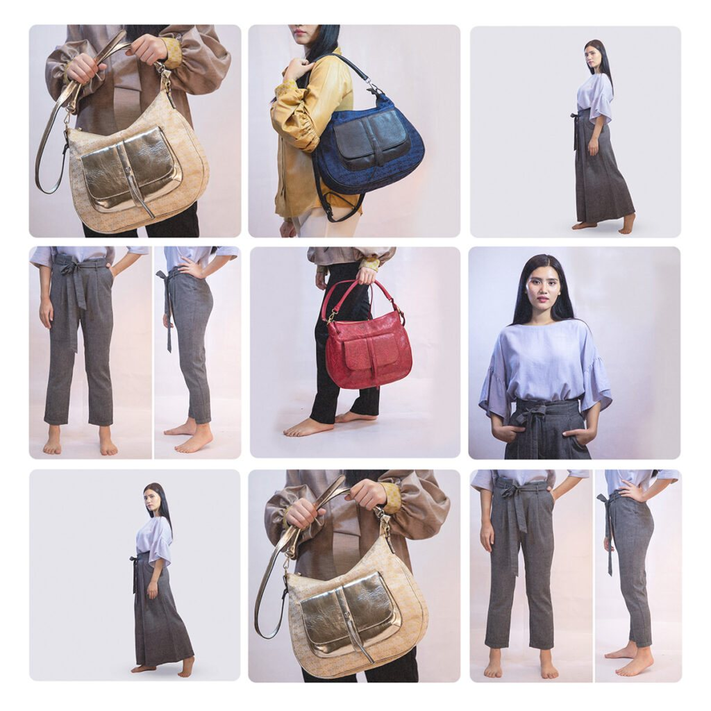

### The Collection

Sparkle this season with handcrafted handloom apparels.

2019 has been a year filled with captivating fashion statements. Summer and spring have had their turn. Now it's fall and winter's — a combination of classy and edgy, with a touch of traditional motifs and patterns that belongs entirely to the Northeast.

The collection is handcrafted with attention to detail — wintery blues and greys that suit the frostiness of the season, with pops of fall colours to brighten up the day. Outfits and accessories that can be worn anywhere.

### 01 — Colors

Grey, blue, beige, red, gold, black — a Denim Look for every winter occasion.

Carefully selected to match the season — attractive without drawing unnecessary attention, calm without being too subtle. Perfectly matched, allowing you to dress completely in pieces from the collection.

### 02 — Style

Each item styled with care. Because it's handcrafted, careful attention is paid to every detail.

The *Valpa Jem* motif — a beautiful Kuki traditional motif meaning stars — is used on select apparels. Made with local handloom fabrics that feel great on the skin, this collection can be worn to the office, for a dinner date, or even for a visit to the mall.

Two types of grey pants — straight and palazzo — that can suit any body type. Bags in beige, blue, and red that can be carried anywhere this season and beyond.

### 03 — Versatility

Wear it to brunch, lunch, dinner — or to work. Style it for spring and summer too.

The apparels in this collection are versatile in both design and colour. While you can wear them together, you can also style them with other outfits. Wrap up 2019 looking edgy and modern.

This new handloom collection creates the perfect fashion statement for the end of the year. Wrap up your 2019 looking edgy and modern.
