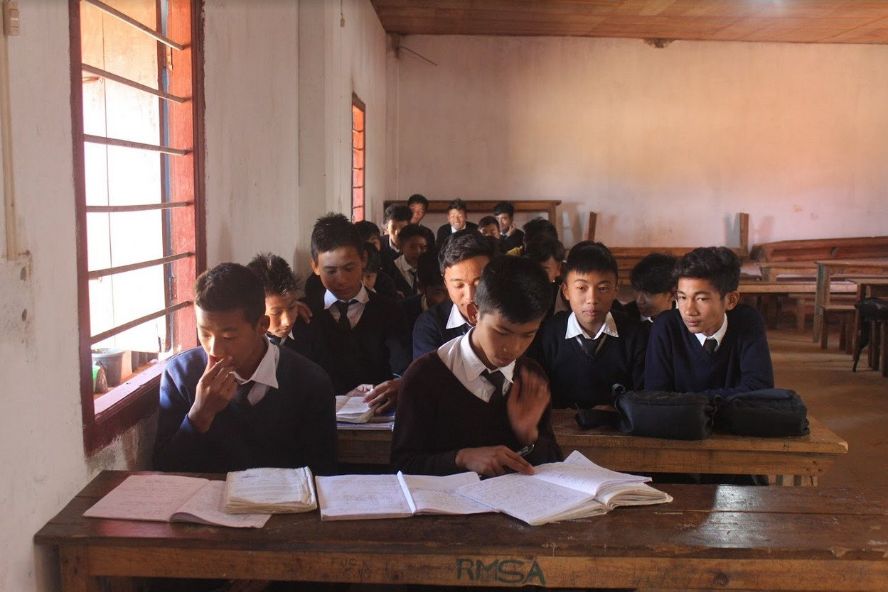
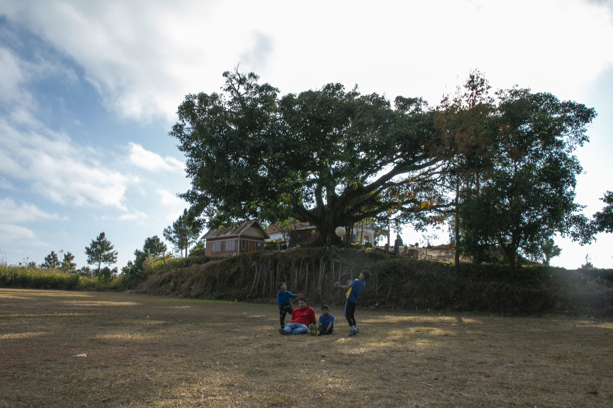
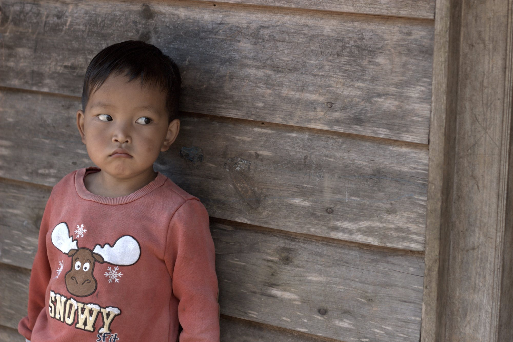
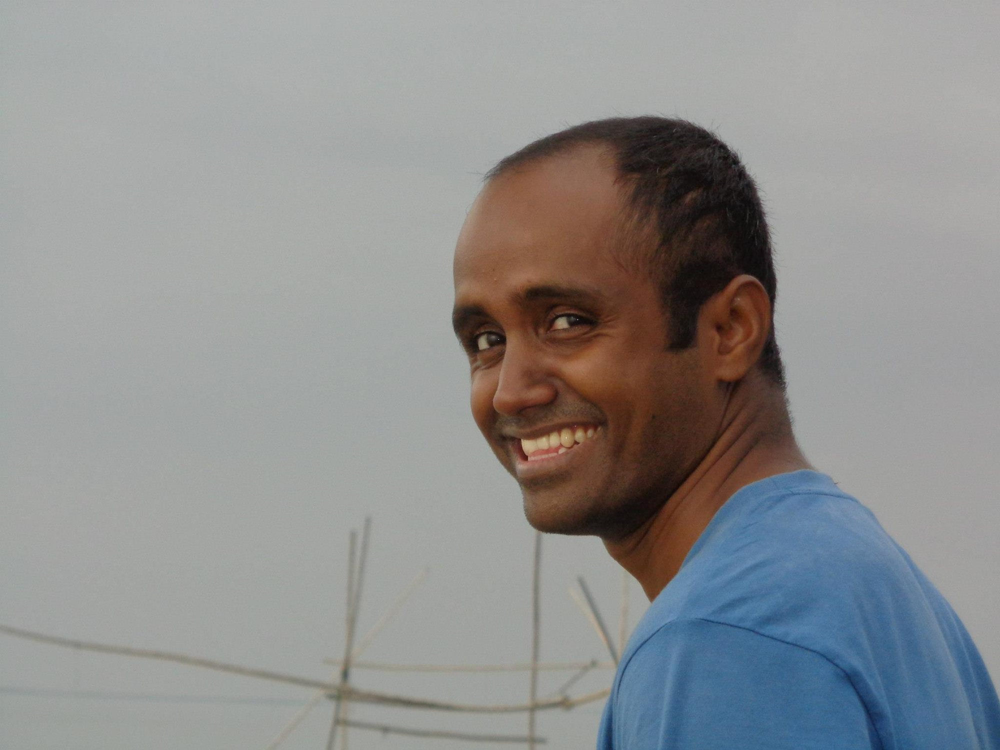
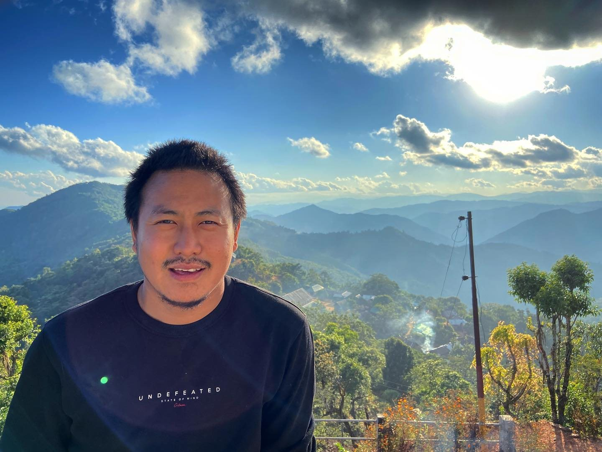

Someone wise had rightly put it. We all have heard many stories and watched films based on the lives of ordinary people achieving extraordinary milestones for a better world, but we never thought we'd be working with one of such heroes. Life is full of circles, as they say, and it holds just right sometimes.

Isn't it just wonderful how the most beautiful stories of life take place at the most unexpected times and places? On a fine summer afternoon in 2019, we met [Mathanmi Hungyo](https://rrea.co.in/management/) at Shosa's Kitchen while we were having our usual — Coffee and Pork.

> "Full disclaimer, it's an odd combination, but we just love it, especially at Shosa's."

Mathanmi is the co-founder of **Recognize, Rise and Empower Association (RREA),** a Sec-8 Company, a non-profit organization based in Imphal, Manipur that works for the socio-economic empowerment and sustainable development of women in and around the troubled peripheries of North East India and the neighbouring South East Asian countries.

THE *CONVERSATION*

What started as a casual over-the-coffee talk led us to share and re-learn together the distressing plights that lie in the current education system of the state, especially in the hilly regions. Most people might think we have advanced significantly, and yet we still have a long-way ahead. Once we visit schools just a few miles outside the capital city, we still witness a world that is stuck behind, like an entirely different universe surviving on its own.

> "What started as a casual over-the-coffee talk led us to re-learn together the distressing plights of the education system in the hilly regions."

We talked about the need to break the walls that existed in our society and connect the dots to create a chain of hope. We shared ideas, exchanged numbers, hugs and smiles, with an assurance to work together in the future, we bid warm goodbyes.

A few months later, Mathanmi got in touch regarding a video shoot for [Teach For North-East](https://teachfornortheast.org/) in Kamjong, a remote hill district of Manipur bordering Myanmar. Teach For North East Fellowship, an initiative by RRAE, is an opportunity for all who believe that every child deserves an education that helps them bring out their truest self to serve the world better.

> These stories always remained untold. Unattended and unresolved.

KAMJONG

About a 3-hour drive from Imphal on a fine sunny day with scenic lush landscapes on the sidelines, but the road ahead from Kamjong towards the village had been worn out and needed repair. During the entire journey, we kept exchanging ideas and plans for overcoming the multiple issues faced by the locals — prejudices, discrimination, and the many other daily challenges.

We travelled down to Kamjong High School for the video shoot. We interacted with the students, parents, and fellowship members of RREA at the school. Every individual we came across unveiled various challenges regarding connectivity, lack of infrastructure, and the impacts of insurgency that ran inside every family dwelling in the locality.

THE *PEOPLE*

Nischal Mothkuri

From Hyderabad,who confessed it to be one of his toughest projects. To see someone who had worked with technology giants like Microsoft quit his job, leave home, and come to such a part of the country to help teach children not only surprised us but inspired us deeply. Students had an irreplaceable soft corner for Nischal, going to him for matters well outside of his teaching work. He had made himself a part of their lives with no bigger plans other than helping these kids have a brighter future.

Mathanmi Hungyo

A passionate young man, and probably one of the most genuinely hardworking people of the entire state, trying desperately to spread positivity and bring real concrete change, one school at a time. His crooked infectious smile spreads charm and enthusiasm wherever he goes. He talked us through the ugly realities that the villagers live with to this day, about how strongly insurgency affects the lives of every family member. Parents would rather send their children away from home so they could seek a better future. Such was the dream for every parent in the village.

RECOGNIZE, RISE AND *EMPOWER*

RRAE brings proficient teachers to schools with absent teaching systems. They are inclined to imparting knowledge not based on rote learning, but on understanding concepts and asking questions, centred towards improving critical thinking. They have sparked the fire to learn and are using this golden opportunity to nurture growing minds.

They are an inspiration not just to students, but to us. If you think you have the potential to help or know someone who can join the movement today by applying or donating what you can at Teach For NorthEast under RREA.
