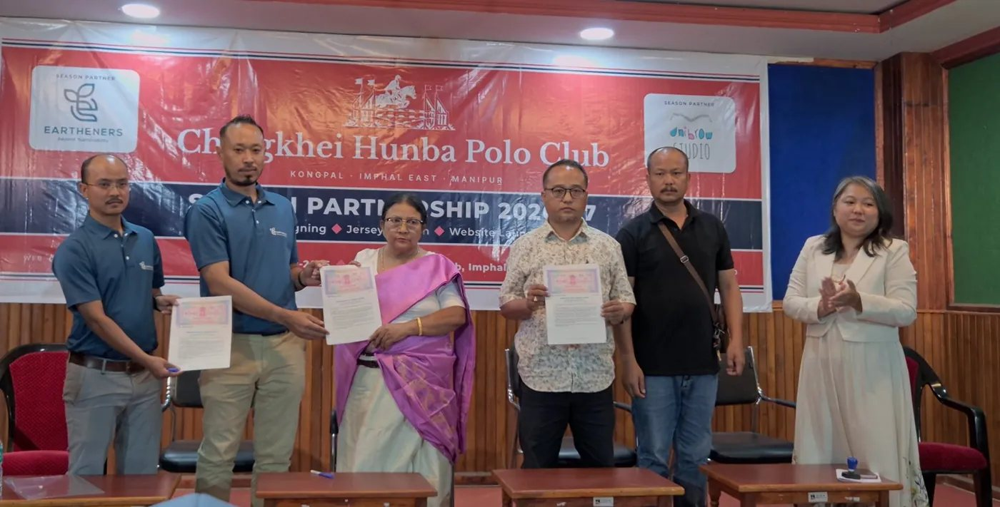
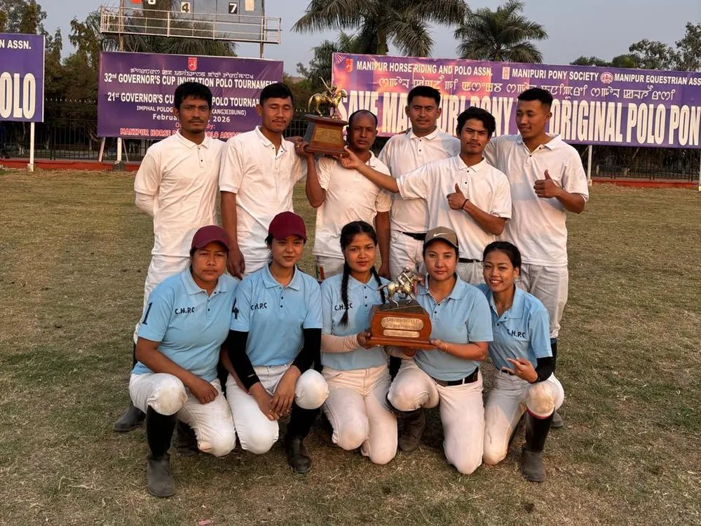
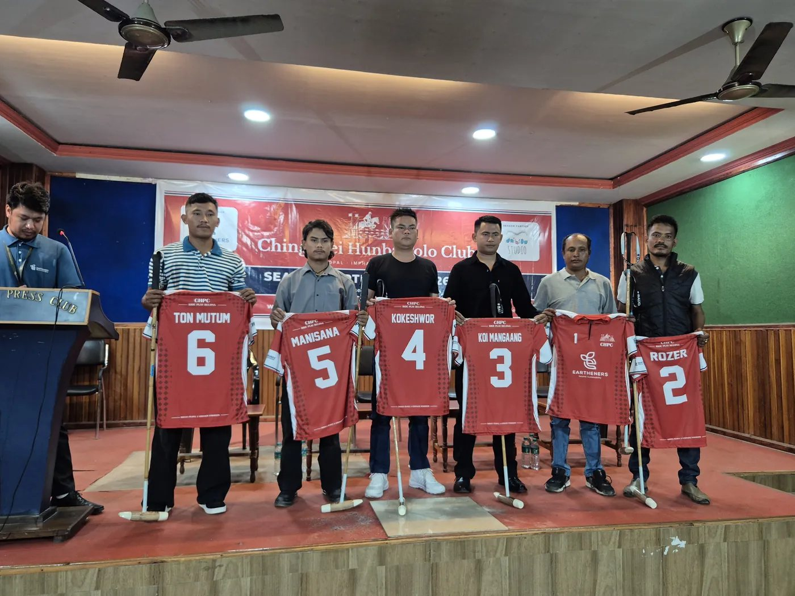
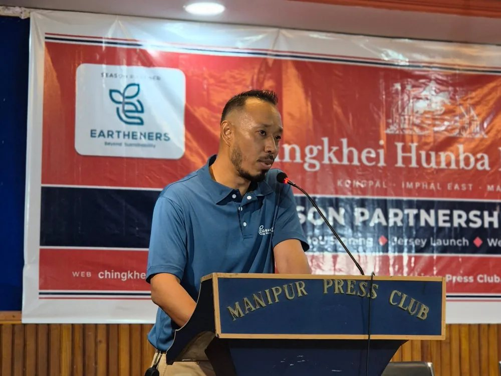
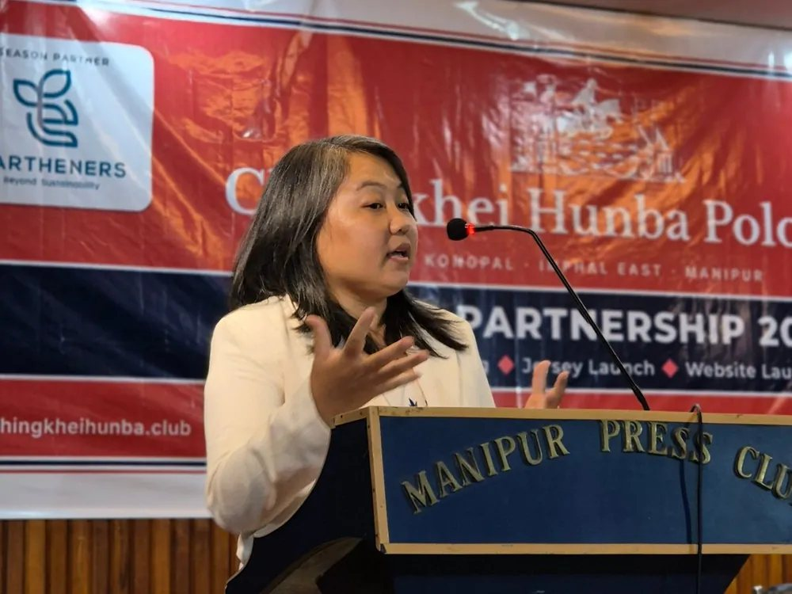
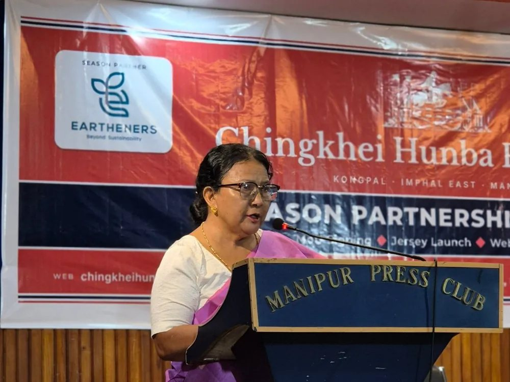
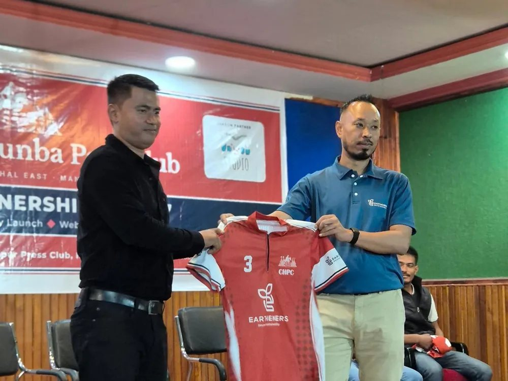
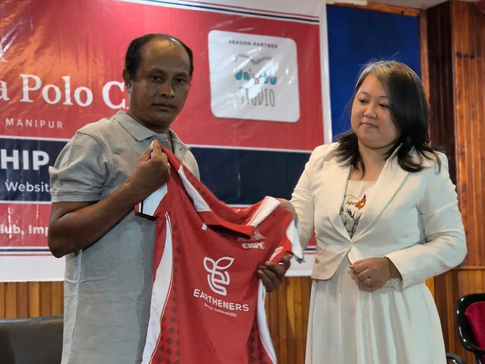
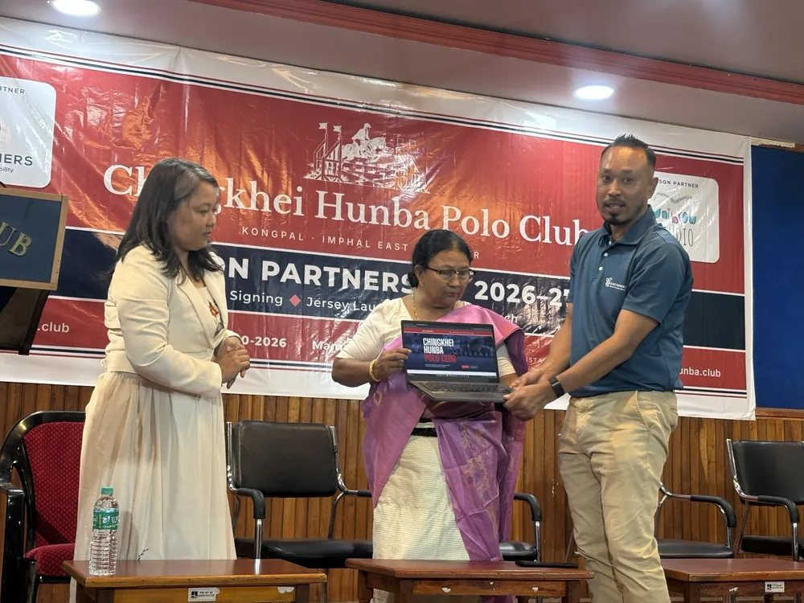

## A SMALL THING, FROM TWO SMALL BUSINESSES

Everyone talks about saving the Manipuri pony. Chingkhei Hunba Polo Club, from Kongpal in Imphal East, has been doing it, quietly, for years.

On **7 October 2026**, at the Manipur Press Club in Imphal, the club signed a season partnership for 2026–27 with our friends at [Eartheners](https://earthene.rs) and with us, Unibrow Studio. The season runs from October 2026 to April 2027. This is why it matters to us, and what it covers.

## A MANIPUR COMPANY, BEHIND A MANIPUR GAME

Eartheners was started in Manipur. It was incorporated in Imphal in January 2013, its head office is still here, and its work has grown from a first solar home light at Heirok to rooftops, health centres and livelihoods across the North East. It began as a social enterprise, and the reason it exists has not changed: to make a positive difference in the places where it lives and works.

Polo is a game born on this soil. The modern game, the one played today from England to Argentina, was learned from Manipuri players riding Manipuri ponies. Here at home, it is still kept going mostly by its players, out of love for it. Our polo players earn almost nothing from the game. Even when they win, the prize money does not cover the cost of caring for their ponies.

If indigenous, home-grown brands don’t stand behind a game born on this soil, who will?

That is the whole reason. Standing behind a home-grown Manipur club felt like the most natural thing to do.

## WHERE MODERN POLO BEGAN

Games played on horseback with a stick and a ball go back well over a thousand years across Asia, from Persia to China. In Manipur the game is Sagol Kangjei, played on the small, hardy Manipuri pony, and it has been part of life here for centuries: on royal grounds, at festivals and in villages.

In the 1850s, British officers stationed in neighbouring Cachar watched Manipuri players and were taken with the game. In 1859, Lieutenant Joseph Sherer, now often called the father of modern polo, and Captain Robert Stewart formed a club at Silchar to play it. The game travelled with them to Calcutta, where the Calcutta Polo Club, founded in 1862, is the oldest polo club still playing today.

From India, cavalry officers carried the game to England, where the first formal British rules were drawn up at the Hurlingham Club in the 1870s. Within a few decades polo was being played across the world. The teams got smaller and the ponies got bigger.

The game the world plays today began here, in Manipur, and its first ponies were Manipuri ponies.

Imphal still has the game’s old home: Mapal Kangjeibung, often described as the oldest polo ground in the world. Polo is played there to this day.

> We are not sponsors. We would like to be a shadow member of the club, standing quietly behind it.
>
> — Eartheners & Unibrow Studio

## KEEPERS OF THE MANIPURI PONY

Chingkhei Hunba means the Rising Sun. The club was started in 1995, out of love for ponies, and Thoudam Thoinu Devi has been its President ever since.

- **About 1,000** Manipuri ponies left, according to the 2019 Livestock Census
- **About 100** ponies looked after by this one club
- **1 in 10** of every Manipuri pony still living

There is no big budget behind that, and no fanfare. Just its players and members, feeding the ponies, training them and caring for them when they fall ill, season after season.

The club plays well, too. On 28 February 2026, at Mapal Kangjeibung, its men’s team won the 32nd Governor’s Cup Invitation and its women’s team won the 21st Governor’s Cup Women’s tournament, on the same afternoon.

*Both Governor’s Cup titles, Mapal Kangjeibung, 28 February 2026.*

## WHAT THE PARTNERSHIP COVERS

Our idea is simple: to take a little of the weight off the club’s shoulders, in whatever small way we can, and stand behind it. Through the 2026–27 season, Eartheners supports the club’s six-player team, and Unibrow Studio helps the club tell its own story.

### Tournament Support

Support to the club before each of the season’s main tournaments.

### Monthly Practice Honorarium

A monthly honorarium for each player, paid directly into the player’s own bank account, with no conditions attached.

### Registration & Affiliation

The team’s registration and affiliation fees with the polo associations.

### Season Jerseys

Two sets of jerseys for each player.

### The Club’s Own Digital Home

We set up the club’s website and its Instagram and Facebook pages. The website and the pages belong to the club.

### Photography & Film

We will photograph and film selected matches, so the club can tell its story in its own voice.

Beyond what the MoU sets out, we will try to do a little more, whenever we can. At the launch, each player also received a new polo mallet, a *kangjei* in Manipuri, to start the season with.

*The team for 2026–27, with new jerseys and new mallets.*

The team for the season:

1. Thoudam Kaoba Singh
2. Okram Rozer Singh
3. Leishemba Takhellambam
4. Laiphrakpam Kokeshwor Singh
5. Thoudam Manisana Singh
6. Mutum Bhupendrajit Meitei

You can [meet them on the club’s website](https://chingkheihunba.club/team/).

## THE AFTERNOON AT THE PRESS CLUB

The club’s President, Thoudam Thoinu Devi, and its Secretary, Thongam Jotin Singh, signed the MoU for the club, with Soraisam Devakishor Singh for Eartheners and Tedawnshim Khaling for Unibrow Studio. The club’s Treasurer, Mutum Bidyananda Singh, and Moirangthem Rameshwar Singh signed as witnesses. The President launched the club’s website, [chingkheihunba.club](https://chingkheihunba.club), the players received their new jerseys and mallets, and then the club surprised us with jerseys of our own.

*Soraisam Devakishor Singh, Eartheners*

*Tedawnshim Khaling, Unibrow Studio*

*Thoudam Thoinu Devi, Club President*

*Handing over a 2026–27 jersey*

*The Unibrow jersey reveal*

*Launching chingkheihunba.club*

> We thank Eartheners and Unibrow Studio for the effort they have put into supporting our players for the 2026–27 season. Our players give their time to polo and to their ponies out of love for the game, and this support will help them practise more regularly and make a real difference to them through the season. We believe this will grow into a relationship that benefits all of us in the years ahead, and we hope more businesses will stand with polo clubs in Manipur.
>
> — Thoudam Thoinu Devi, President, Chingkhei Hunba Polo Club

*Players, club members, partners and guests after the launch.*

Local polo clubs in Manipur have long had jersey sponsors, patrons and well-wishers, and they have done a great deal for the game. As far as we know, this is the first time a local club has had season partners, with support going directly to its players. We hope it will not be the last.

You can read the club’s own account of the day [on its website](https://chingkheihunba.club/news/season-partnership-eartheners-unibrow-studio/).
