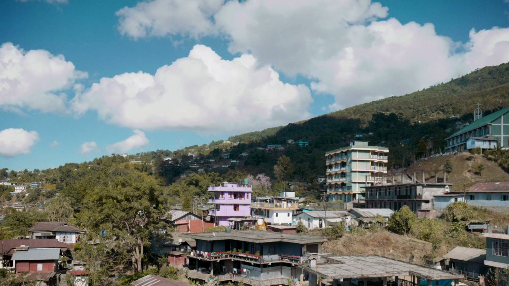

## CRITICAL CARE FOR COMMUNITIES THAT NEED IT MOST

The 10BedICU Project by the eGov Foundation is a transformative healthcare initiative to strengthen critical care infrastructure in remote and underserved areas of India. By equipping district hospitals with state-of-the-art 10-bed ICU units, the project ensures timely access to quality healthcare — particularly during emergencies and pandemics.

This initiative leverages cutting-edge technology, streamlined processes, and local partnerships to deliver life-saving care to communities that need it most, fostering a healthier and more resilient nation.

## TELLING A STORY THAT MATTERS

Healthcare initiatives of this scale are often communicated through data and reports. Our role was to do something different — to find the human story inside the system and bring it to the surface.

The film needed to communicate both the urgency and the hope of the 10BedICU project: the lives at stake in remote districts, and the very real change being created by putting a functional ICU within reach of communities that previously had none.

> Life-saving care delivered to the communities that need it most.
>
> — 10BedICU Project, eGov Foundation

## HUMAN STORIES INSIDE SYSTEMIC CHANGE

Rather than leading with statistics or infrastructure, we anchored the film in the people — the doctors working with limited resources, the patients who might not have survived without timely care, the local staff trained to operate these units.

The 10BedICU project is ultimately about proximity — bringing a life-saving resource closer to the people who need it. Our film tried to carry that same philosophy: get close, stay human, let the significance speak for itself.

## A FILM THAT PUT A FACE TO LIFE-SAVING INFRASTRUCTURE

A brand film that communicated the scale and urgency of the 10BedICU initiative — giving the project a human voice to carry its mission beyond policy documents and into the hearts of the people it serves.
