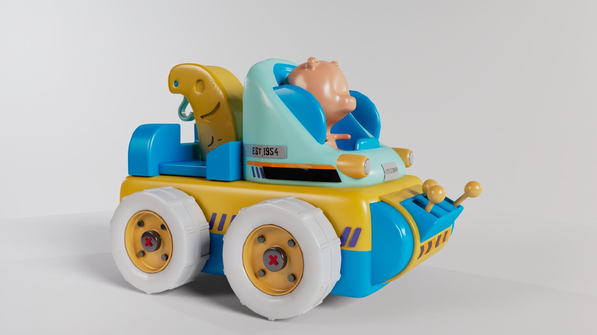
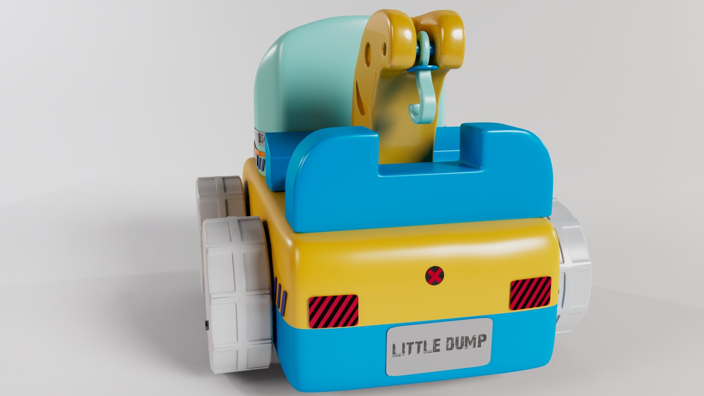
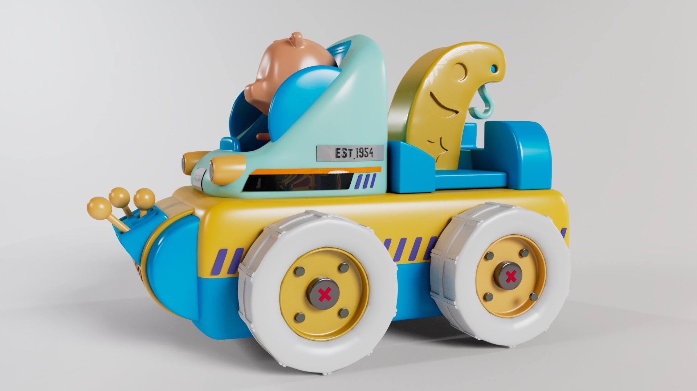
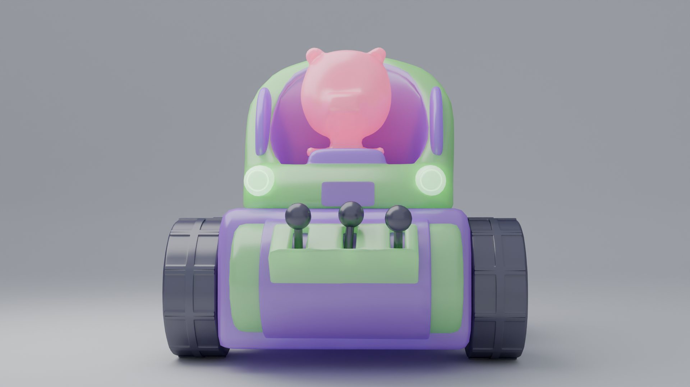
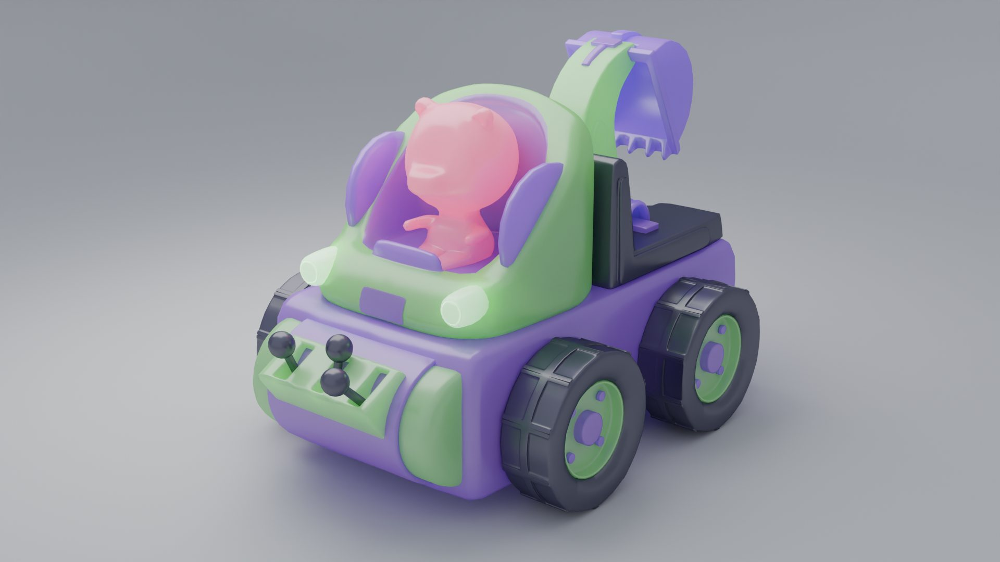

## SEEING THE PRODUCT BEFORE IT EXISTS

3D visualisation of a toy design using Blender. Our goal was to provide the client with an accurate representation of the toy's colours, textures, and overall look before production.

The 3D model was carefully crafted to showcase the toy from multiple angles, ensuring that every detail — from the material and finishes to the colour choices — was faithfully represented.

## EVERY ANGLE, EVERY DETAIL

The final result was a high-resolution, photorealistic render that allowed the client to experience the toy design in its final form — fully. This visualisation allowed them to make informed decisions about colour adjustments and design refinements, all without the need for physical prototypes.

Multiple colourways were explored and presented, giving the client a complete picture of how the product would look across different finish options.

> See every detail before production — no prototypes needed.

## PHOTOREALISTIC RENDERS THAT REPLACED PROTOTYPES

High-resolution renders across multiple angles and colourways that gave the client full confidence in the design — before a single physical prototype was made.
