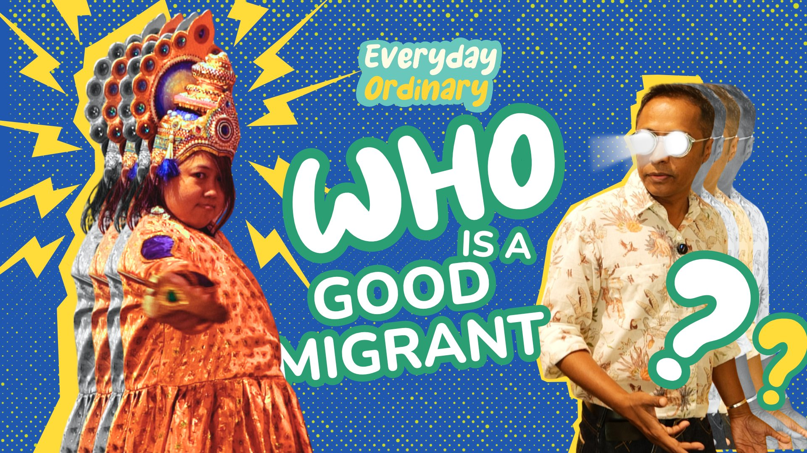
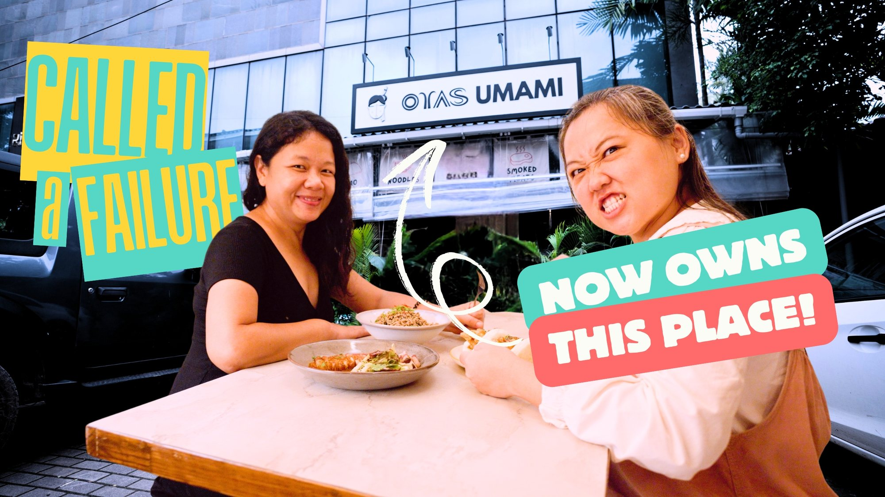
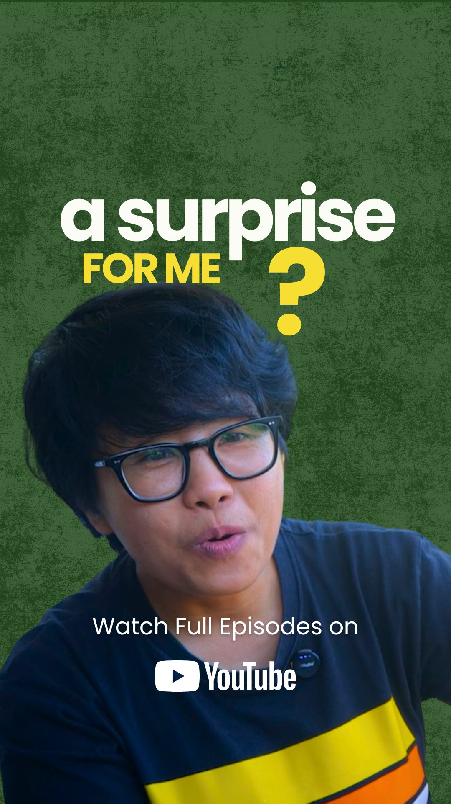
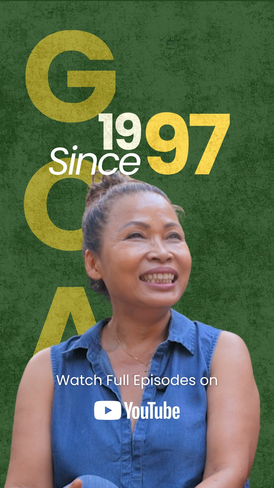
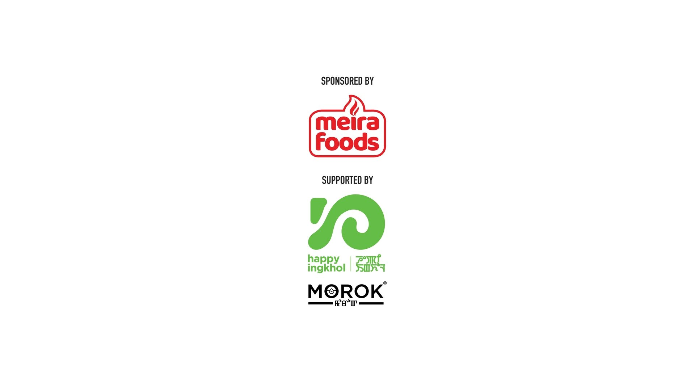

## UNIBROW SPEAKING IN ITS OWN VOICE

Everyday Ordinary is not a client project. It is Unibrow Studio speaking in its own voice.

We made it because we noticed something: audiences are exhausted. The internet is loud, relentless, and increasingly artificial — algorithm-chasing content, manufactured emotion, drama engineered for clicks. In that environment, the rarest thing you can offer someone is quiet honesty.

Everyday Ordinary is an unscripted documentary series that sits with real people in their real lives — daily wage earners, artists, small business owners, local characters — and simply watches. No narration that editorialises. No conflict that is staged. No story arc imposed from the outside.

## SLOW CONTENT PHILOSOPHY

We call our approach slow content. Not slow in pace necessarily, but slow in philosophy — stories built to stay with you rather than pass through you.

We use the full weight of our documentary toolkit: considered cinematography, intentional composition, immersive sound design. The same craft we bring to any high-end production, pointed at ordinary life.

> In a world of noise, authenticity is the signal.

## COMPLETE CREATIVE AUTONOMY

Everyday Ordinary is where Unibrow exercises complete creative autonomy. No brief, no brand guidelines, no approval chain.

It is the best demonstration we have of what we believe: that you do not need to manufacture chaos to hold attention. You do not need to raise your voice to be heard. You just need to mean it.

## AN ONGOING ORIGINAL SERIES

An ongoing original series that is entirely, unapologetically Unibrow — and proof that the most compelling content does not always begin with a client.
