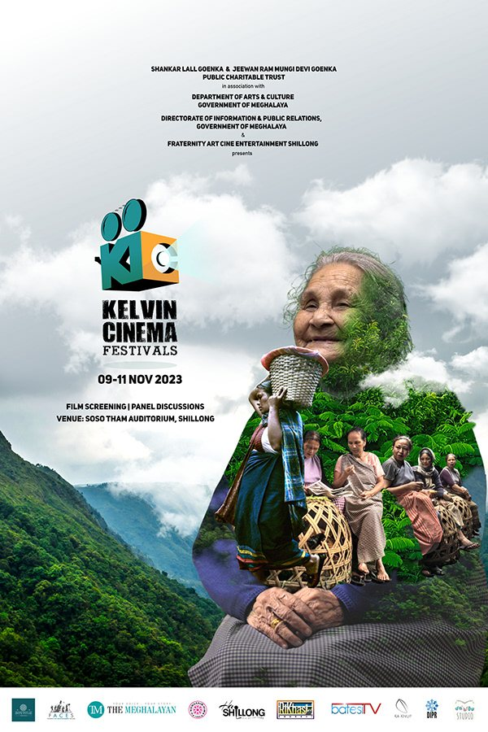
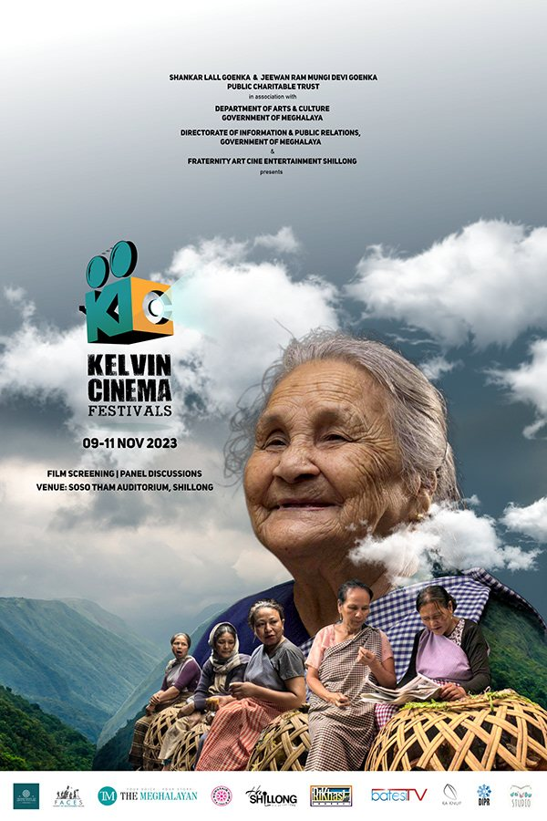

## HONOURING A CINEMA HALL THAT SHAPED A CITY

Kelvin Cinema Festival (KCF) is named after Shillong's once-famed cinema hall — a tribute to its memory after it was gutted by fire. Kelvin Cinema Hall was founded by Rai Bahadur Jeevan Ram Goenka in 1926, the first talkies in Shillong.

As Design Partner for the 2023 edition, our role was to build a visual identity that carried the weight of that history — something that felt rooted in the spirit of the Northeast, cinematic in its sensibility, and worthy of the community it was made for.

## DESIGN ROOTED IN MEMORY & PLACE

The visual language of KCF 2023 had to do two things at once — feel celebratory and carry grief. A festival built on the ashes of a beloved hall needs design that acknowledges both the loss and the continuity.

We drew from the visual vocabulary of classic South Asian cinema — bold typography, rich colour, graphic composition — and filtered it through a contemporary lens that felt fresh without being disconnected from the community it was speaking to.

> A festival built on memory deserves design that remembers.

## EVERY TOUCHPOINT, CONSIDERED

As Design Partner, our work extended across the full festival identity — from key art and posters to social media assets and collateral. Every touchpoint was treated as an opportunity to deepen the festival's relationship with its audience.

The result was a cohesive visual world that felt like it belonged to Shillong — specific, proud, and built with care for the city and its cinematic history.

## A VISUAL IDENTITY WORTHY OF SHILLONG'S CINEMA HISTORY

A complete festival design system that honoured Kelvin Cinema Hall's legacy — giving KCF 2023 a visual presence as memorable as the stories it celebrated.
