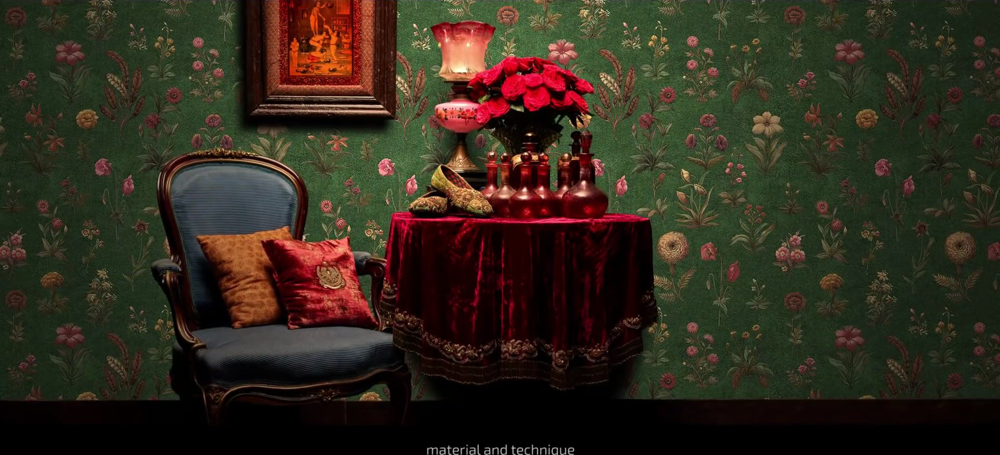
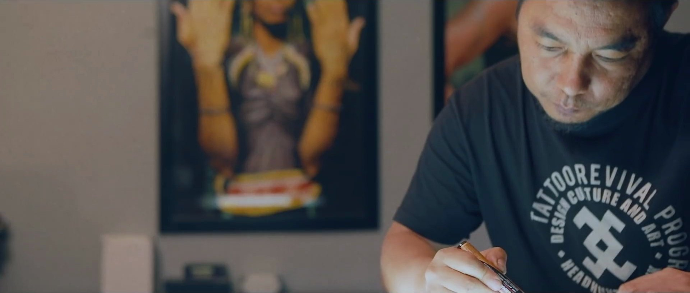
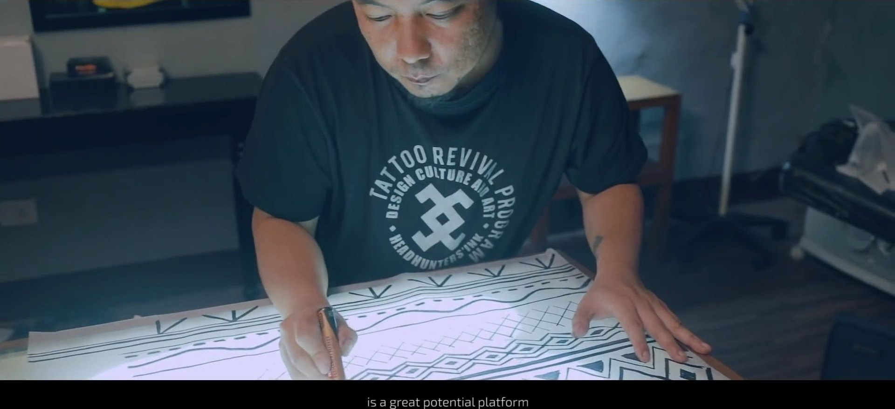
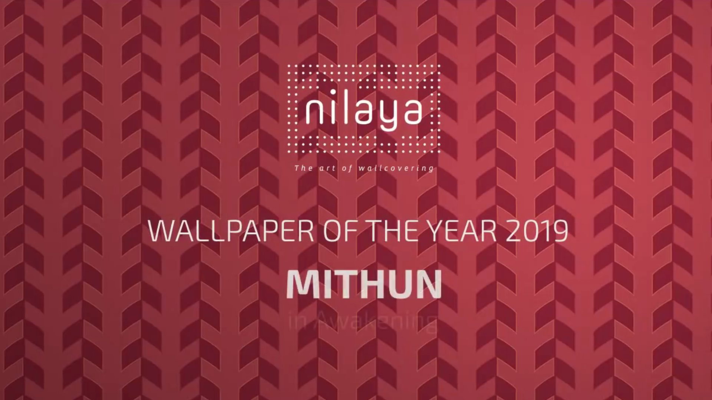

## WHERE TATTOO ART MEETS INTERIOR DESIGN

A short documentary highlighting the design created by renowned tattoo artist Mo Naga in 2019 for Asian Paints Nilaya — featured at the India Design ID event during the launch of the Nilaya wallpaper collection.

Mo Naga is one of Northeast India's most celebrated artists — a tattoo artist whose work draws from Naga tribal traditions and reinterprets them for contemporary audiences. Being commissioned by Asian Paints Nilaya to create a wallpaper design was a significant moment — and it deserved to be documented properly.

## DOCUMENTING A MOMENT IN INDIAN DESIGN CULTURE

The documentary followed Mo Naga through the process — from the conception of the design to its presentation at India Design ID, one of India's most prominent design events. We wanted to capture not just the finished wallpaper but the thinking behind it — the artist's relationship with his cultural roots and his approach to translating that into a product for contemporary interiors.

The result was a film that worked both as a record of the collaboration and as a standalone piece about an artist at the intersection of tradition and modernity — the kind of story that Unibrow has always believed deserves to be told.

> An artist at the intersection of tradition and modernity — a story that deserves to be told.

## NORTHEAST INDIA ON THE NATIONAL DESIGN STAGE

India Design ID is one of the most significant design events in the country. Having Mo Naga's work — rooted in Naga tribal art — featured there was a meaningful moment for Northeast Indian culture on a national platform.

This documentary was our way of making sure that moment was captured with the same intention and care that Mo Naga brought to the design itself. Stories from the Northeast deserve a stage — and we were glad to help build one.

## A DOCUMENTARY THAT GAVE NORTHEAST ART A NATIONAL STAGE

A short documentary that captured Mo Naga's collaboration with Asian Paints Nilaya — placing Northeast Indian artistic tradition at the centre of one of India's most prominent design events.
