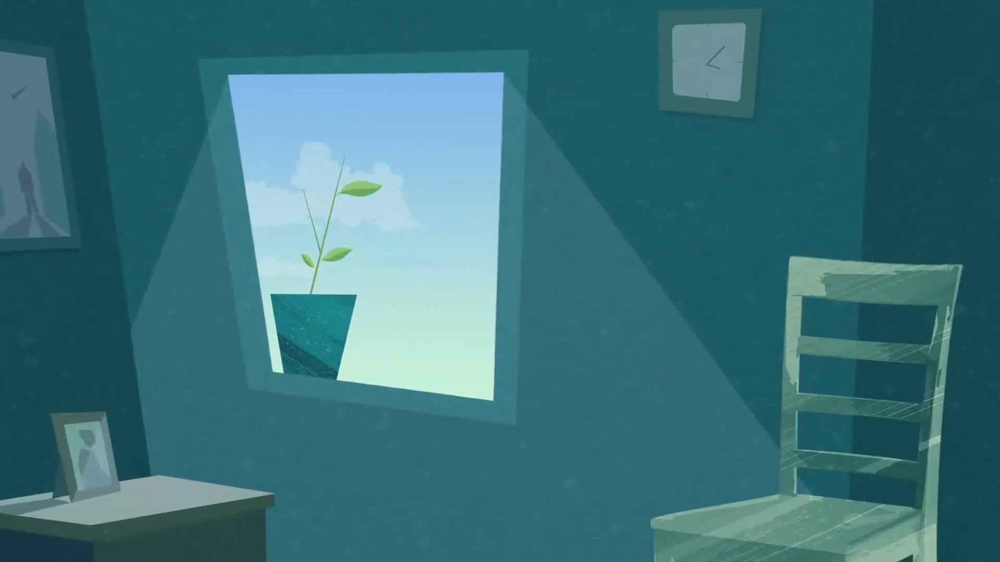
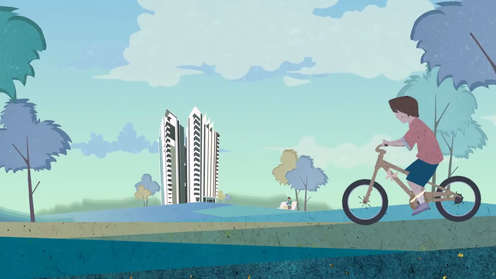
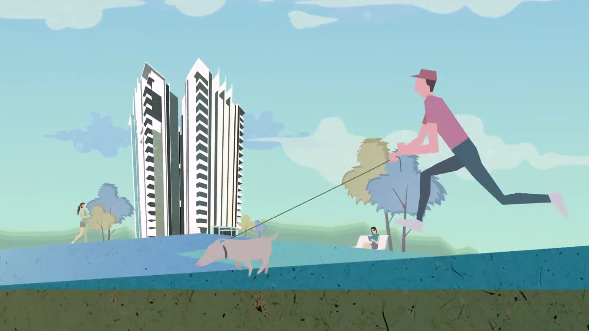
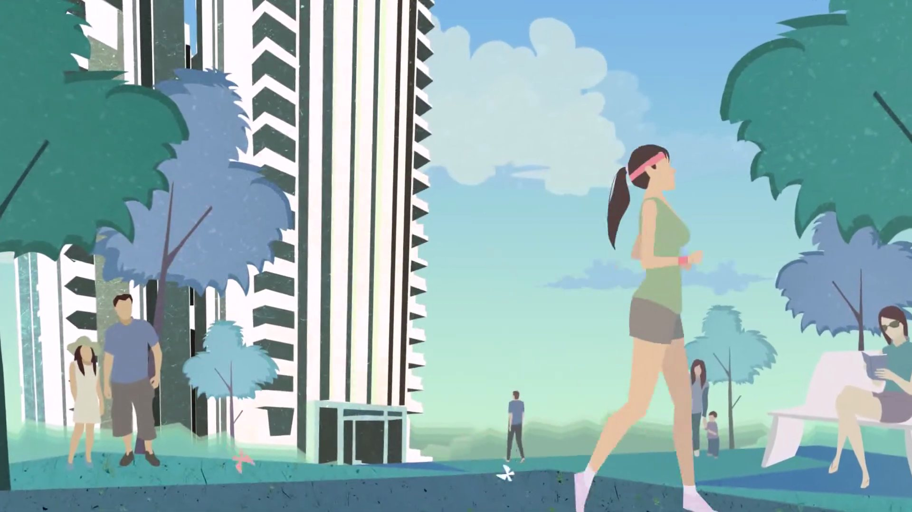

## LUXURY LIVING COMMUNICATED WITH CLARITY & MOTION

Parkwest is a flagship residential development by Shapoorji Pallonji in Bengaluru — one of India's most respected real estate names. The brief was a short motion graphics ad that could showcase the project's luxury living and modern amenities through simple, engaging visuals.

Real estate advertising often overcrowds the frame — too many features, too much text, too little breathing room. We took the opposite approach: give each element space, let the motion do the storytelling, and trust the viewer to understand what premium actually looks like.

## MOTION THAT MAKES SPACE FEEL ALIVE

The design language of Parkwest — clean lines, premium materials, open spaces — informed every motion decision. We used smooth transitions, considered typography, and a restrained colour palette to let the project's inherent quality come through rather than oversell it.

Motion graphics for real estate work best when they feel inevitable — when each frame follows naturally from the last, and the whole piece feels as considered as the architecture it's representing. That's what we aimed for.

> Give each element space. Let the motion do the storytelling.

## SIMPLE, ENGAGING, PRECISELY MADE

The final ad is short, clean, and purposeful — every visual element earning its place on screen. The motion is fluid without being flashy, the hierarchy is clear, and the overall feel is exactly what a Shapoorji Pallonji project deserves: confident, refined, and unmistakably premium.

It's the kind of work where the craft is most visible in what isn't there — the unnecessary elements that were removed, the moments of stillness that were preserved, the restraint that makes the whole piece feel authoritative.

## A MOTION AD AS REFINED AS THE PROJECT IT REPRESENTS

A short motion graphics ad that communicated Parkwest's luxury positioning with clarity and confidence — giving one of India's most respected real estate brands a visual presence that matched its reputation.
