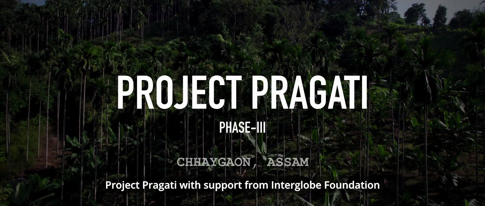
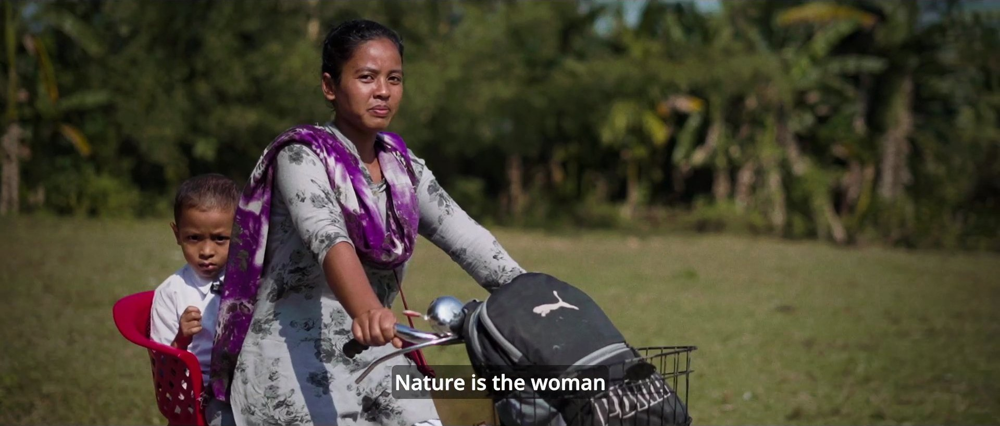
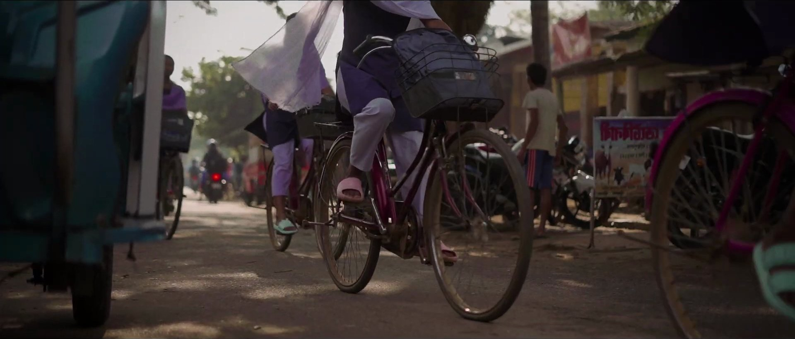
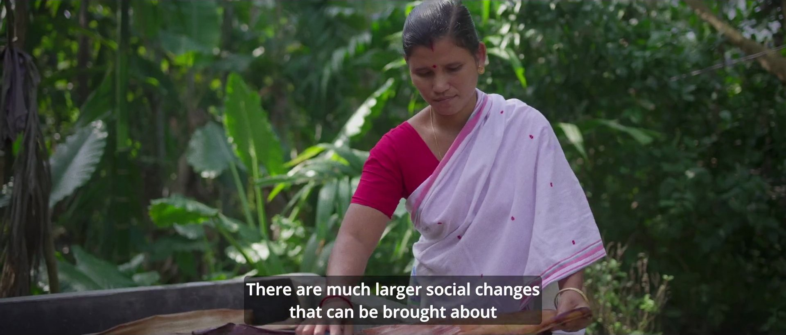
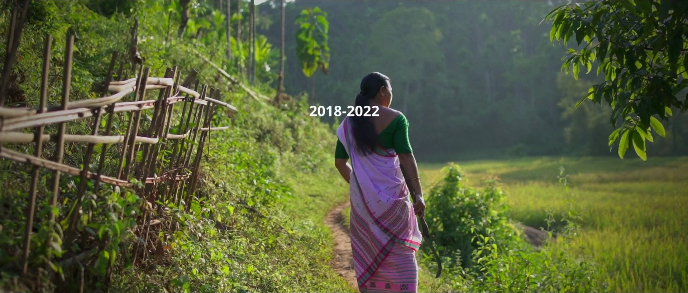
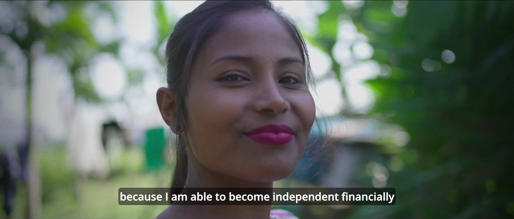
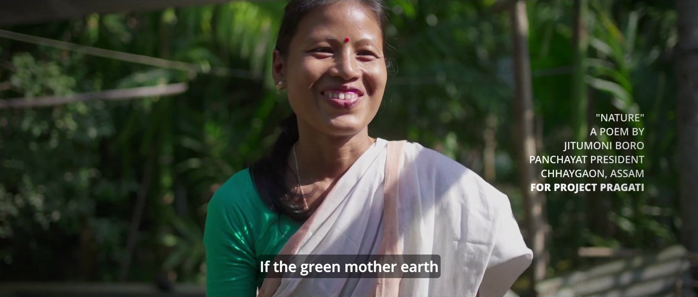
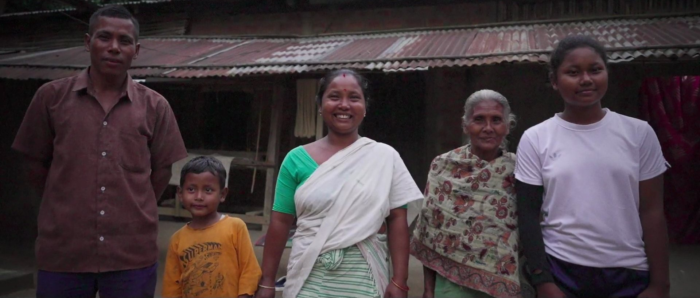

## STORIES OF CHANGE THAT DESERVE TO BE TOLD

Project Pragati Phase III is a social initiative by Dhriiti Foundation and Interglobe Foundation aimed at empowering underserved communities through skill development and sustainable entrepreneurship. This documentation project captures the impact of the program — showcasing the transformation in the lives of individuals who have benefitted from the training and resources provided.

The goal was to create a short, compelling impact story that highlights the success of participants — demonstrating the positive changes brought about by Project Pragati's efforts in fostering entrepreneurship, skill-building, and financial independence.

## REAL PEOPLE, REAL JOURNEYS

We captured real-life stories through interviews, visuals, and testimonials that reflect the personal journeys of the beneficiaries. The focus was on portraying the program's tangible results — the growth of small businesses, the creation of sustainable livelihoods, and the quiet confidence that comes from having a skill and a market to serve.

Impact documentaries live or die by authenticity. We made sure every frame felt earned — no manufactured emotion, no staged moments. Just people speaking honestly about the difference a program made in their lives.

> Real stories of transformation — told with the craft they deserve.

## ADVOCACY THROUGH STORYTELLING

The final documentation serves as both a testament to the success of Phase III and a powerful tool for advocacy and future fundraising efforts. It effectively communicates the lasting impact of the initiative — helping stakeholders understand the value of continued investment in such social programs.

We approached the edit as we would any good documentary — finding the emotional arc within the material, letting the best moments breathe, and building to a conclusion that left the viewer with both hope and a clear understanding of what the program achieved.

## A DOCUMENTARY THAT MADE IMPACT VISIBLE

An impact documentary that gave Project Pragati's stakeholders a powerful, human story to carry forward — for advocacy, fundraising, and proof of the program's lasting value.
