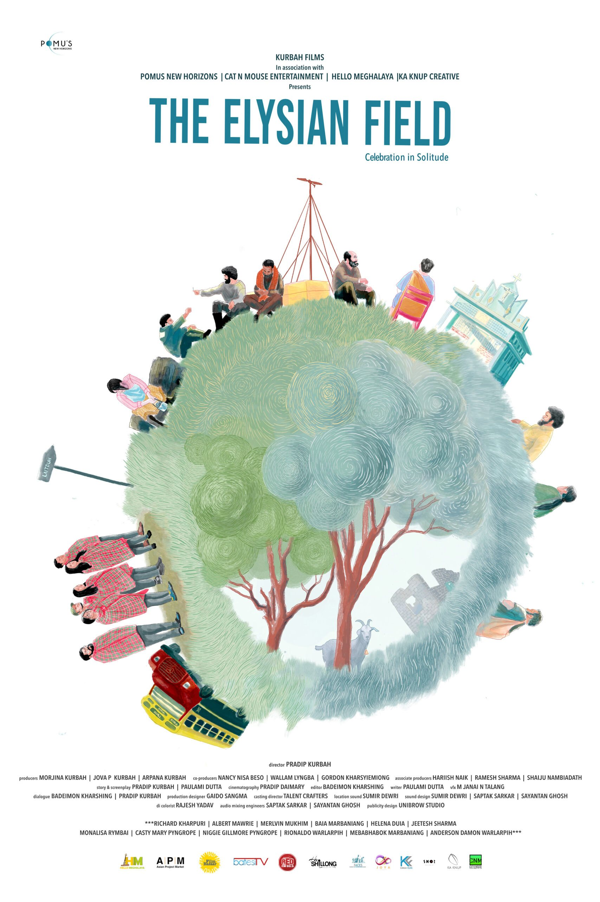
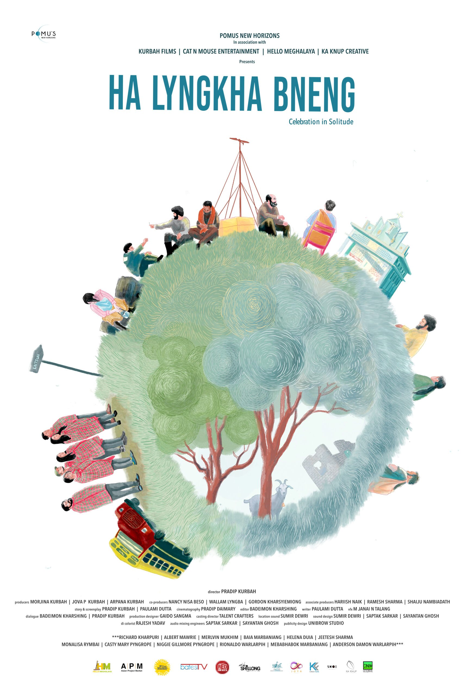

## A STORY OF LOVE, LOSS & RESILIENCE

The Elysian Field is a film that illuminates the profound beauty of human connection against the backdrop of inevitable change. Set in the tranquil Khasi Hills, Meghalaya, India in 2047, the story follows Livingstone and his fellow villagers as they grapple with the intertwined forces of loss, love, and resilience.

At its heart, The Elysian Field celebrates the unbreakable bonds of community. In a village now home to only six souls — reduced so drastically by the pull of urban migration — friendship becomes a lifeline, offering solace in the face of loneliness.

## CAPTURING SOLITUDE WITH GRACE

The poster needed to carry the weight of the film's themes — nostalgia, hope, and the quiet dignity of a shrinking community — in a single visual. Every design choice had to feel as intentional and unhurried as the film itself.

Nostalgia and hope intertwine as the narrative unfolds with poignant grace. Livingstone's journey aboard a vintage bus becomes a symbolic pilgrimage — a testimony to the enduring love he holds for his late wife, Belinda. The poster had to hold all of that without saying too much.

> Bound together by shared experiences, they weave a tapestry of hope.
>
> — The Elysian Field

*Main Poster — The Elysian Field*

*Alternate — Ka Lyngkha Bneng*

## SIX SOULS, ONE VILLAGE

Alongside Livingstone, a group of endearing individuals each wrestles with personal dreams and desires, set against the haunting reality of dwindling village life.

Yet, in times of both triumph and adversity, these six villagers stand as beacons of resilience. Their collective spirit proves unyielding despite the uncertainties that lie ahead — bound together by shared experiences, reminding us of timeless truths about love, loss, and the fortifying power of solidarity.

## POSTERS THAT CARRY THE WEIGHT OF THE FILM

Two distinct poster designs — one in English, one in Khasi — that honour the film's themes of solitude, community, and resilience through considered visual craft.
