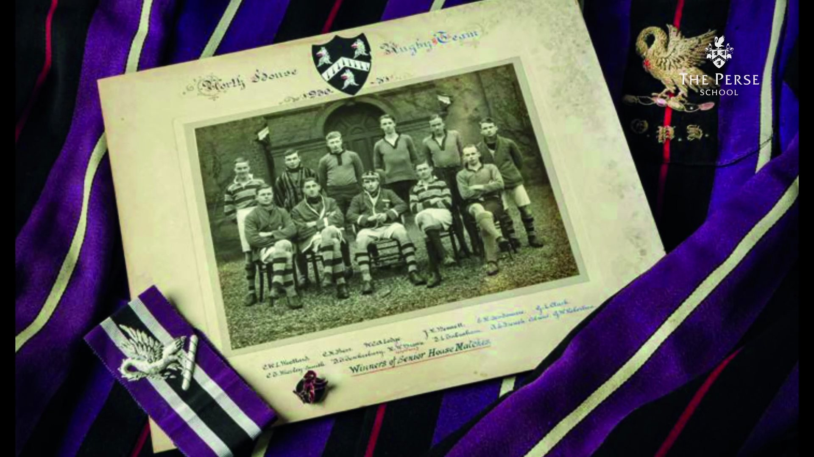
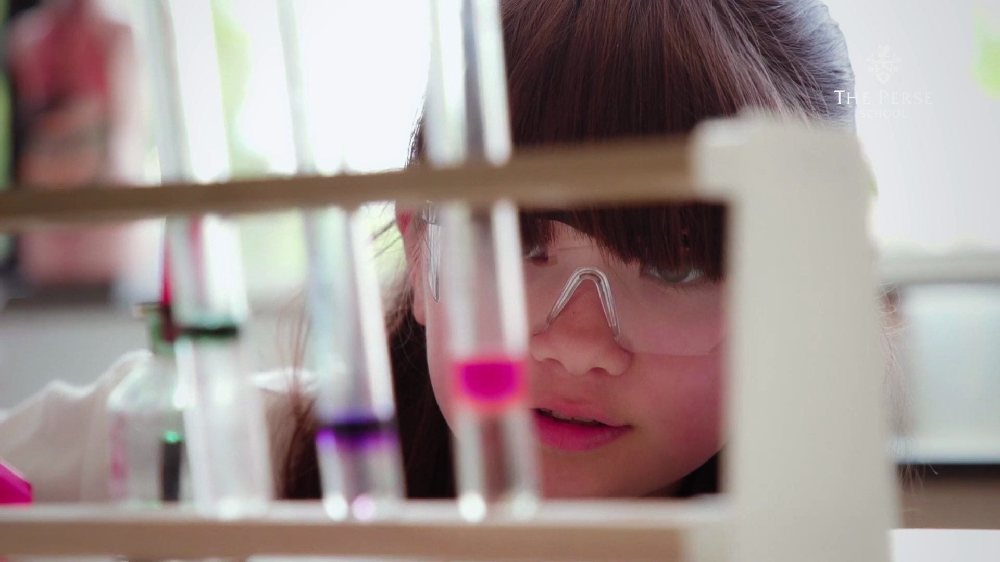
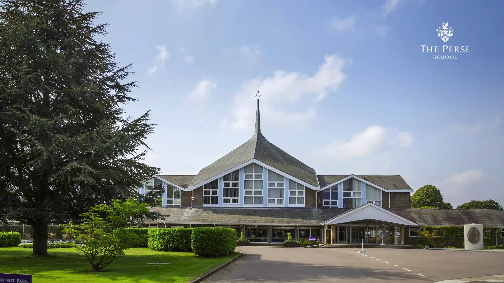
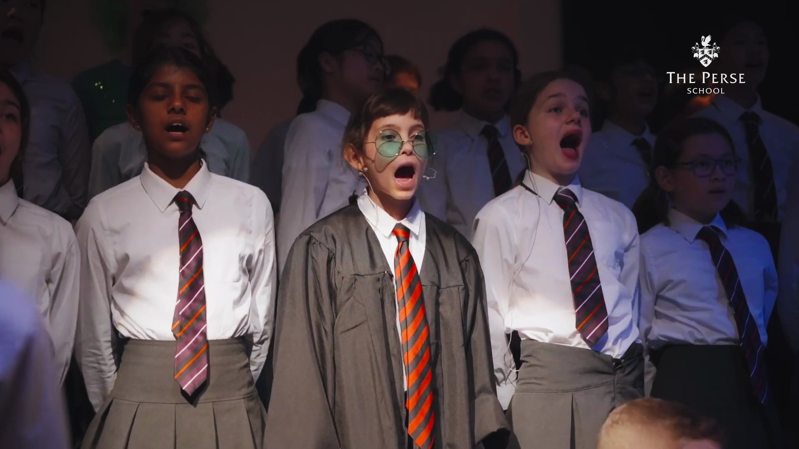

## INTRODUCING A SCHOOL THAT FELT DIFFERENT

The Perse School Singapore is an international school rooted in over four centuries of Cambridge academic tradition, opening its doors at a brand new campus in Upper Bukit Timah. The challenge was to introduce a school that many in Singapore hadn't heard of yet — and to do it in a way that felt warm and human, not institutional.

The brief called for a promotional film that could speak to prospective families across two very different platforms. On YouTube, parents would watch with intention. On Instagram, the film had to earn attention quickly. Both versions needed to communicate the same thing: that The Perse School isn't just academically rigorous — it's a place where children genuinely want to be.

## LET THE ENVIRONMENT SPEAK

We structured the film around the school's philosophy — "The Perse Way" — an approach that goes beyond grades to develop curiosity, character, and balance. Rather than leading with credentials or facilities, we let the environment speak.

The campus, the spaces, the people — each frame was designed to feel alive and considered, the way a good school should. The tone was deliberately unhurried. In a market crowded with high-pressure messaging, we chose to stand apart by trusting the audience to feel the difference.

> In a market of high-pressure messaging, we chose to trust the audience to feel the difference.

## BEYOND GRADES — CHARACTER & CURIOSITY

The Perse Way is about more than academic achievement. It's a philosophy that nurtures the whole child — developing curiosity, fostering resilience, and building the kind of confidence that lasts beyond the classroom.

Our film had to hold that philosophy without stating it flatly. Every edit decision, every moment of breathing space, every choice to linger on a face or a corridor or a conversation — all of it served the same purpose: to make families feel what The Perse School is, not just hear about it.

## A FILM THAT GAVE FAMILIES A GENUINE SENSE OF THE SCHOOL

A promotional film that introduced The Perse School Singapore with confidence and clarity — giving prospective families a genuine sense of the school before they ever booked a tour.
